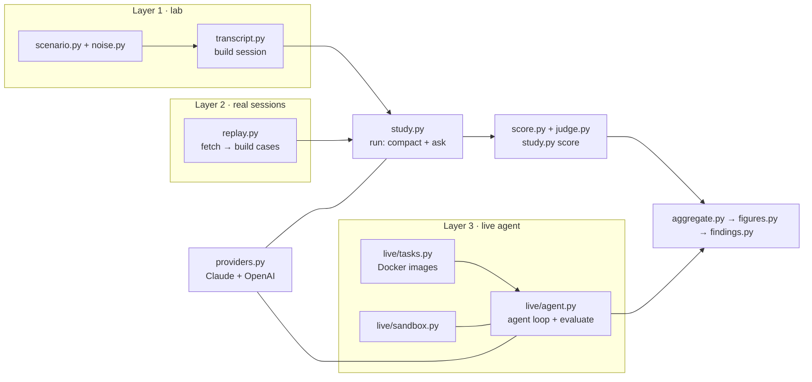

# Code map

Everything is plain Python (3.13) with three dependencies (`anthropic`, `openai`, `matplotlib`) plus `python-dotenv`.
Docker is only needed for layer 3.

## Shared: talking to the two APIs: `lab/providers.py`

| Function | What it does |
|---|---|
| `build_adapter("claude", "claude-haiku-5-5")` / `build_adapter("openai", "gpt-6-luna")` | Create an adapter (keys from `.env`) |
| `adapter.convert(turns)` | Neutral turns (`user` / `assistant` + tool calls / `tool` results) → the provider's message format |
| `adapter.compact(state, instructions)` | **Native compaction.** Claude: Messages API with `compaction={"type": "summarize"}` (beta `compact-2026-09-04`), returns the readable summary block as the new state. OpenAI: `responses.compact`, returns the kept user messages + the encrypted compaction item. `instructions` = keep-exact prompt or `None` |
| `adapter.ask(state, prompt)` | One question on a copy of the state, tools disabled |
| `adapter.step(state, system)` / `tool_results(...)` | One agent turn with tools enabled, and the reply that carries tool outputs (layer 3) |

Both adapters use the same effort (medium), output limits and retry policy.

## Layer 1 and 2: `lab/study.py`

| Step | Code |
|---|---|
| Plan the run matrix | `python -m lab.study plan --layer a|b` |
| Build the starting state per strategy | `run_job()`: full history = `convert(all turns)`; drop old outputs = `transcript.mask_old_tool_outputs()`; compaction = feed parts one by one and call `compact()` after each of the last *k* parts (Claude: consecutive same-role messages are merged) |
| Ask the questions | `LabProbes` (layer 1: quiz, state, action) or `replay.ReplayProbes` (layer 2: quiz, state); each question is a separate `ask()` on the same final state |
| Score | `score_run()`: exact matching in `lab/score.py` (`classify()` gives CORRECT / UNKNOWN / STALE / DECOY / INVENTED / OTHER_WRONG), rollout-plan checks in `score_action()`, why-questions and next steps through `lab/judge.py` (one batched call per run, cached) |
| Output | `runs/<layer>/<run>/` and `results/items_<layer>.jsonl` |

**Layer 1 inputs:**
- `lab/scenario.py` holds `FACTS` (29 facts and their traps), `DECISIONS` (8 why-questions), `ACTION_TEMPLATE`, `VIOLATIONS` (the 7 rules) and `GUIDED_INSTRUCTIONS` (the keep-exact prompt).
- `lab/probe.py` builds the question prompts.

**Layer 2 inputs:** `lab/replay.py`:
- `convert_row()` turns a SWE-agent turn into a native tool call;
- `choose_cut()` picks where to cut, skipping steps the agent itself called a mistake;
- `split_phases()` makes 4 equal parts;
- `GENERATOR_PROMPT` and `verify_recall()` write the questions and check them;
- `gate()` is the full-history quality check.

## Layer 3: `lab/live/`

| File | Key functions |
|---|---|
| `tasks.py` | `select()` picks bugs from SWE-bench Verified; `dockerfile()` + `build()` build one image per bug (repo at the base commit, pinned dependencies); `validate()` checks hidden tests fail before / pass after the gold fix; `run_tests()` and the log parsers read pytest and sympy output |
| `sandbox.py` | `Sandbox(image)` starts the container (`--network none --memory 1g --cpus 1`); `exec()` (120 s timeout, output capped at 12,000 chars), `read()`, `edit()`, `diff()` |
| `agent.py` | `run_one()` runs the loop (step → run tools → send results), counts characters added since the last compaction and calls `compact()` at the trigger, then sends `CONTINUE_TEXT`. `evaluate()` applies the agent's diff plus the hidden tests in a fresh container. `compute_metrics()` counts fixed, steps, re-reads, repeated failures, rules kept and false success |

## Results: `lab/aggregate.py` → `lab/figures.py` → `lab/findings.py`

- `aggregate.py` turns every scored answer into run scores, then averages per model, strategy and number of compactions, with bootstrap / Wilson intervals, and applies the hand-review verdicts in `data/safety_adjudication.json`.
- `figures.py` draws the charts.
- `findings.py` writes `findings/`.

## Tests

`python -m unittest discover -s tests` runs offline tests with fake adapters and a fake sandbox, without API calls.
They cover scoring cases, message conversion, role merging, the replay conversion and cut, live metrics, log parsers
and the charts.

## Also in `lab/`

`run.py`, `report.py` and `extract.py` are the runner for the earlier 10-model comparison (3 Claude + 7 GPT
models on the lab session), kept for reference.
