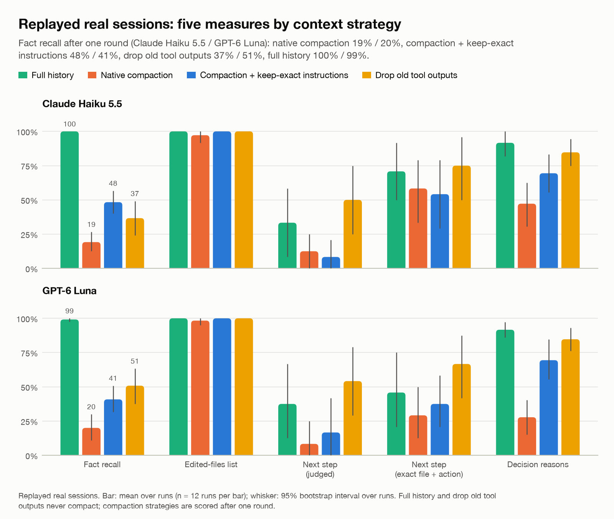
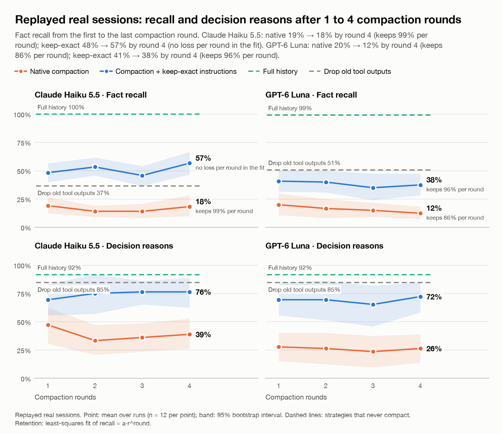
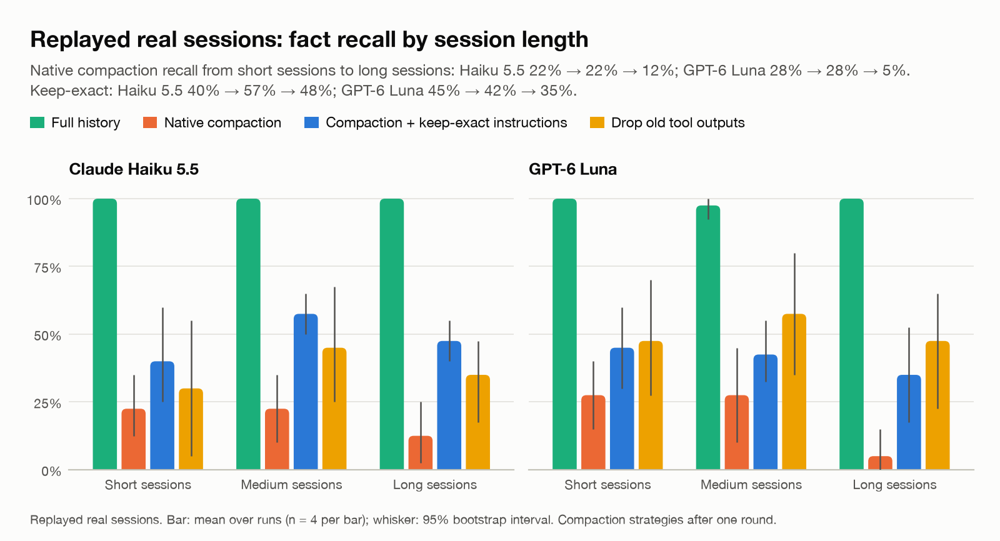
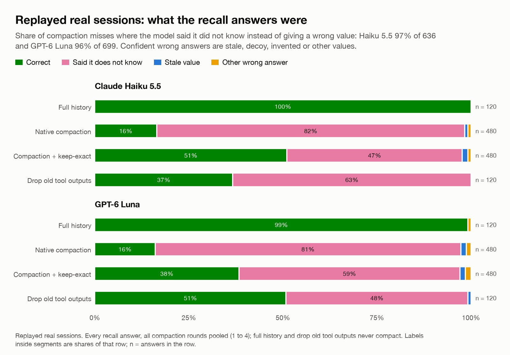

# Layer 2 · Real sessions, replayed

Recordings of a real agent (SWE-agent, Llama-70B based) fixing real bugs, from the public dataset
[`nebius/SWE-agent-trajectories`](https://huggingface.co/datasets/nebius/SWE-agent-trajectories) (CC-BY-4.0).
Each recording is converted to native API tool calls, cut at about 85% (the real next step becomes a question),
and split into 4 equal parts. Questions about exact values were drafted by `gpt-6.1-sol` and kept only when code
verified the answer word for word in a tool output and not in the bug report. With the full recording both models
answer 99–100% of them.

**Matrix:** 12 sessions × 2 models × (full, drop old outputs, default compaction 1–4, keep-exact 1–4) = **240 runs**.
Brackets show 95% intervals bootstrapped over the 12 sessions.

## The 12 sessions

| Repository | Task | Agent actions | Tokens before the cut | Size group |
|---|---|---|---|---|
| `CODAIT/exchange-metadata-converter` | 38 | 45 | 24,068 | short |
| `Infinidat/munch` | 93 | 33 | 26,372 | medium |
| `NCAS-CMS/cfdm` | 158 | 31 | 30,640 | long |
| `PyPSA/PyPSA` | 784 | 33 | 23,785 | short |
| `gahjelle/pyplugs` | 29 | 39 | 23,405 | short |
| `mie-lab/trackintel` | 217 | 30 | 23,844 | short |
| `nylas/nylas-python` | 81 | 36 | 26,688 | medium |
| `openlawlibrary/pygls` | 252 | 50 | 33,167 | long |
| `pydantic/pydantic` | 1174 | 32 | 25,567 | medium |
| `python-babel/flask-babel` | 230 | 51 | 31,093 | long |
| `simphony/simphony-remote` | 117 | 53 | 27,760 | medium |
| `spdx/tools-python` | 467 | 55 | 30,794 | long |

## Headline: every measure after one compaction

*Chart data: [`charts/data/headline_b.csv`](charts/data/headline_b.csv) · vector: [`charts/headline_b.svg`](charts/headline_b.svg)*

**Claude Haiku 5.5**

| Strategy | Recall (exact values) | Files edited (F1) | Reasons (judge) | Next step (judge) | Next step (file + action) |
|---|---|---|---|---|---|
| Full history | 100% | 100% | 92% (82–100) | 33% (8–58) | 71% (50–92) |
| Drop old tool outputs | 37% (24–49) | 100% | 85% (75–94) | 50% (25–75) | 75% (50–96) |
| Default compaction | 19% (12–27) | 97% (92–100) | 47% (31–62) | 12% (0–25) | 58% (33–79) |
| Keep-exact compaction | 48% (40–57) | 100% | 69% (56–83) | 8% (0–21) | 54% (29–79) |

**GPT-6 Luna**

| Strategy | Recall (exact values) | Files edited (F1) | Reasons (judge) | Next step (judge) | Next step (file + action) |
|---|---|---|---|---|---|
| Full history | 99% (98–100) | 100% | 92% (86–97) | 38% (12–67) | 46% (21–75) |
| Drop old tool outputs | 51% (38–63) | 100% | 85% (76–93) | 54% (29–79) | 67% (42–88) |
| Default compaction | 20% (11–30) | 98% (95–100) | 28% (15–40) | 8% (0–25) | 29% (12–50) |
| Keep-exact compaction | 41% (32–51) | 100% | 69% (56–85) | 17% (0–42) | 38% (21–58) |

The next-step measures compare against the one step the original agent really took; several steps are often
reasonable, so read them as direction, not precise rates.

## 1 to 4 compactions

*Chart data: [`charts/data/rounds_b.csv`](charts/data/rounds_b.csv) · vector: [`charts/rounds_b.svg`](charts/rounds_b.svg)*

| Model | Strategy | 1 | 2 | 3 | 4 |
|---|---|---|---|---|---|
| Claude Haiku 5.5 | Default compaction | 19% | 14% | 14% | 18% |
| Claude Haiku 5.5 | Keep-exact compaction | 48% | 53% | 46% | 57% |
| GPT-6 Luna | Default compaction | 20% | 17% | 15% | 12% |
| GPT-6 Luna | Keep-exact compaction | 41% | 40% | 35% | 38% |

Real sessions hit the floor at the first compaction; later passes change little.

## Longer sessions lose more (1 compaction)

*Chart data: [`charts/data/size_b.csv`](charts/data/size_b.csv) · vector: [`charts/size_b.svg`](charts/size_b.svg)*

| Model | Strategy | Short | Medium | Long |
|---|---|---|---|---|
| Claude Haiku 5.5 | Full history | 100% | 100% | 100% |
| Claude Haiku 5.5 | Drop old tool outputs | 30% | 45% | 35% |
| Claude Haiku 5.5 | Default compaction | 22% | 22% | 12% |
| Claude Haiku 5.5 | Keep-exact compaction | 40% | 57% | 48% |
| GPT-6 Luna | Full history | 100% | 98% | 100% |
| GPT-6 Luna | Drop old tool outputs | 48% | 57% | 48% |
| GPT-6 Luna | Default compaction | 28% | 28% | 5% |
| GPT-6 Luna | Keep-exact compaction | 45% | 42% | 35% |

## Honesty (all compactions pooled)

*Chart data: [`charts/data/outcomes_b.csv`](charts/data/outcomes_b.csv) · vector: [`charts/outcomes_b.svg`](charts/outcomes_b.svg)*

| Model | Strategy | CORRECT | UNKNOWN | STALE | DECOY | INVENTED | OTHER_WRONG |
|---|---|---|---|---|---|---|---|
| Claude Haiku 5.5 | Full history | 120 | 0 | 0 | 0 | 0 | 0 |
| Claude Haiku 5.5 | Drop old tool outputs | 44 | 76 | 0 | 0 | 0 | 0 |
| Claude Haiku 5.5 | Default compaction | 79 | 393 | 4 | 0 | 0 | 4 |
| Claude Haiku 5.5 | Keep-exact compaction | 245 | 224 | 7 | 0 | 0 | 4 |
| GPT-6 Luna | Full history | 119 | 0 | 0 | 0 | 0 | 1 |
| GPT-6 Luna | Drop old tool outputs | 61 | 58 | 1 | 0 | 0 | 0 |
| GPT-6 Luna | Default compaction | 77 | 390 | 7 | 0 | 0 | 6 |
| GPT-6 Luna | Keep-exact compaction | 184 | 282 | 7 | 0 | 0 | 7 |
