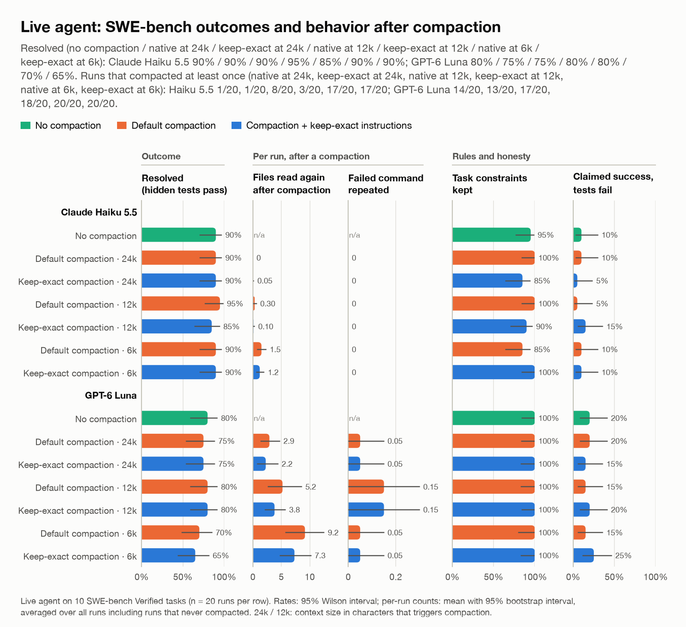

# Layer 3 · A live agent fixing real bugs

Our own agent loop, built directly on the two APIs, fixes 10 real GitHub bugs from **SWE-bench Verified** inside
Docker. Each container holds the repository at the commit just before the real fix, the exact library versions,
no internet, 1 GB of memory and 1 CPU. Before any run we proved the hidden tests fail with the bug and pass with the
real fix.

**The agent gets** the issue text; `bash` (120 s per command), `read_file` (≤ 400 lines) and `edit_file`; three rules
(don't touch tests, delete scratch files, finish with `DONE:` + changed files); 40 steps or 30 minutes. Tool outputs
are capped at 12,000 characters.

**Compaction fires mid-task** whenever the conversation has grown by 24,000 (gentle), 12,000 (medium) or 6,000
(harsh) characters since the last compaction; the agent then gets "Continue with the task." Characters, not
tokens, so both models face identical pressure.

**Judged by** the hidden tests in a fresh container: fixed = the target test passes and no existing test breaks.

**Matrix:** 10 bugs × 7 conditions × 2 attempts × 2 models = **280 runs**. Rates show Wilson 95% intervals over
20 attempts; counts show intervals bootstrapped over runs.

## The 10 bugs

| Repository | Issue | Fix (SWE-bench task) | The bug |
|---|---|---|---|
| `psf/requests` | [#2930](https://github.com/psf/requests/issues/2930) | [PR #2931](https://github.com/psf/requests/pull/2931) | Request with a binary payload fails (`to_native_string`) |
| `psf/requests` | [#6027](https://github.com/psf/requests/issues/6027) | [PR #6028](https://github.com/psf/requests/pull/6028) | Proxy authentication broken |
| `pytest-dev/pytest` | [#5606](https://github.com/pytest-dev/pytest/issues/5606) | [PR #5631](https://github.com/pytest-dev/pytest/pull/5631) | `ValueError` collecting tests that patch an array |
| `pytest-dev/pytest` | [#7215](https://github.com/pytest-dev/pytest/issues/7215) | [PR #7236](https://github.com/pytest-dev/pytest/pull/7236) | `tearDown` runs on skipped tests with `--pdb` |
| `pytest-dev/pytest` | [#7569](https://github.com/pytest-dev/pytest/issues/7569) | [PR #7571](https://github.com/pytest-dev/pytest/pull/7571) | `caplog` doesn't restore the log level after a test |
| `pytest-dev/pytest` | [#9877](https://github.com/pytest-dev/pytest/issues/9877) | [PR #10051](https://github.com/pytest-dev/pytest/pull/10051) | `caplog.get_records` and `caplog.clear` conflict |
| `sympy/sympy` | [#11617](https://github.com/sympy/sympy/issues/11617) | [PR #11618](https://github.com/sympy/sympy/pull/11618) | Wrong distance calculation |
| `sympy/sympy` | [#13779](https://github.com/sympy/sympy/issues/13779) | [PR #13974](https://github.com/sympy/sympy/pull/13974) | Powers of `TensorProduct` don't evaluate |
| `sympy/sympy` | [#15193](https://github.com/sympy/sympy/issues/15193) | [PR #15349](https://github.com/sympy/sympy/pull/15349) | Wrong result from `Quaternion.to_rotation_matrix()` |
| `sympy/sympy` | [#24442](https://github.com/sympy/sympy/issues/24442) | [PR #24443](https://github.com/sympy/sympy/pull/24443) | `_check_homomorphism` broken on permutation groups |

All are rated "15 minutes to 1 hour" for a human.

## Results by condition

*Chart data: [`charts/data/live_c.csv`](charts/data/live_c.csv) · vector: [`charts/live_c.svg`](charts/live_c.svg)*

**Claude Haiku 5.5**

| Condition | Fixed | Steps | Compactions | Runs that compacted | Re-reads after compaction | Ran out of steps | Rules kept (finished runs) | Claimed success, tests fail |
|---|---|---|---|---|---|---|---|---|
| No compaction | 18/20 (90%) | 6.8 (5.8–7.8) | 0.0 (0.0–0.0) | 0/20 | – | 0/20 | 19/20 (95%) | 2/20 (10%) |
| Default · 24k | 18/20 (90%) | 8.3 (7.1–9.7) | 0.1 (0.0–0.2) | 1/20 | 0.0 (0.0–0.0) | 0/20 | 20/20 (100%) | 2/20 (10%) |
| Keep-exact · 24k | 18/20 (90%) | 7.6 (6.5–8.8) | 0.1 (0.0–0.2) | 1/20 | 0.1 (0.0–0.2) | 0/20 | 17/20 (85%) | 1/20 (5%) |
| Default · 12k | 19/20 (95%) | 9.3 (7.5–11.5) | 0.6 (0.3–1.1) | 8/20 | 0.3 (0.0–0.7) | 0/20 | 20/20 (100%) | 1/20 (5%) |
| Keep-exact · 12k | 17/20 (85%) | 7.2 (6.3–8.1) | 0.2 (0.0–0.5) | 3/20 | 0.1 (0.0–0.3) | 0/20 | 18/20 (90%) | 3/20 (15%) |
| Default · 6k | 18/20 (90%) | 11.0 (8.7–13.4) | 2.2 (1.4–3.0) | 17/20 | 1.5 (0.7–2.4) | 0/20 | 17/20 (85%) | 2/20 (10%) |
| Keep-exact · 6k | 18/20 (90%) | 11.0 (8.9–13.3) | 1.8 (1.2–2.4) | 17/20 | 1.2 (0.6–2.0) | 0/20 | 20/20 (100%) | 2/20 (10%) |

**GPT-6 Luna**

| Condition | Fixed | Steps | Compactions | Runs that compacted | Re-reads after compaction | Ran out of steps | Rules kept (finished runs) | Claimed success, tests fail |
|---|---|---|---|---|---|---|---|---|
| No compaction | 16/20 (80%) | 14.7 (12.6–16.8) | 0.0 (0.0–0.0) | 0/20 | – | 0/20 | 20/20 (100%) | 4/20 (20%) |
| Default · 24k | 15/20 (75%) | 18.1 (14.3–22.1) | 1.6 (0.9–2.4) | 14/20 | 2.9 (1.3–4.8) | 1/20 | 19/19 (100%) | 4/20 (20%) |
| Keep-exact · 24k | 15/20 (75%) | 16.7 (13.3–20.5) | 1.3 (0.7–2.1) | 13/20 | 2.3 (0.7–4.5) | 2/20 | 18/18 (100%) | 3/20 (15%) |
| Default · 12k | 16/20 (80%) | 20.3 (15.9–25.4) | 4.0 (2.6–5.8) | 17/20 | 5.2 (2.6–8.6) | 2/20 | 18/18 (100%) | 3/20 (15%) |
| Keep-exact · 12k | 16/20 (80%) | 16.7 (13.5–20.1) | 3.3 (2.0–4.6) | 18/20 | 3.8 (2.1–5.8) | 0/20 | 20/20 (100%) | 4/20 (20%) |
| Default · 6k | 14/20 (70%) | 23.0 (18.2–27.7) | 7.7 (5.3–10.0) | 20/20 | 9.2 (5.7–12.6) | 5/20 | 15/15 (100%) | 3/20 (15%) |
| Keep-exact · 6k | 13/20 (65%) | 20.4 (16.3–24.7) | 6.6 (4.5–8.8) | 20/20 | 7.3 (4.7–10.3) | 2/20 | 18/18 (100%) | 5/20 (25%) |

*Re-reads after compaction*: files opened again that had already been read before the latest compaction (once per
file per compaction). *Rules kept*: no test edits, no leftover files, a correct `DONE:` line.

## Per bug: fixed attempts out of 2

| Bug | Haiku none | Haiku 24k | Haiku 12k | Haiku 6k | Luna none | Luna 24k | Luna 12k | Luna 6k |
|---|---|---|---|---|---|---|---|---|
| requests #2930 | 2/2 | 2/2 | 2/2 | 2/2 | 2/2 | 1/2 | 2/2 | 0/2 |
| requests #6027 | 2/2 | 2/2 | 2/2 | 2/2 | 0/2 | 0/2 | 0/2 | 0/2 |
| pytest #5606 | 2/2 | 2/2 | 2/2 | 2/2 | 2/2 | 2/2 | 2/2 | 2/2 |
| pytest #7215 | 2/2 | 2/2 | 2/2 | 2/2 | 2/2 | 2/2 | 2/2 | 2/2 |
| pytest #7569 | 2/2 | 2/2 | 2/2 | 2/2 | 2/2 | 2/2 | 2/2 | 2/2 |
| pytest #9877 | 2/2 | 2/2 | 2/2 | 2/2 | 2/2 | 2/2 | 2/2 | 2/2 |
| sympy #11617 | 2/2 | 2/2 | 2/2 | 2/2 | 2/2 | 2/2 | 2/2 | 2/2 |
| sympy #13779 | 0/2 | 0/2 | 1/2 | 0/2 | 0/2 | 0/2 | 0/2 | 0/2 |
| sympy #15193 | 2/2 | 2/2 | 2/2 | 2/2 | 2/2 | 2/2 | 2/2 | 2/2 |
| sympy #24442 | 2/2 | 2/2 | 2/2 | 2/2 | 2/2 | 2/2 | 2/2 | 2/2 |

(Default compaction; keep-exact results are in `data/summary.json` under `c.per_task`.)
